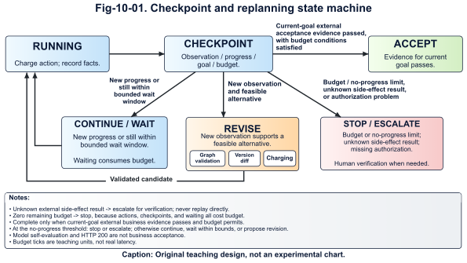
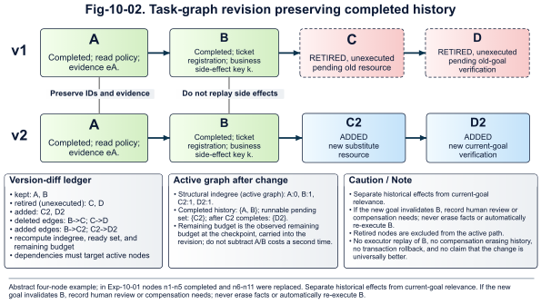

# Ch10 迭代推理与计划修订

**Iterative Reasoning and Plan Revision**

版本：zh-g1-0.4，2026-11-26。

**摘要：** 长程智能体任务常在执行中遇到目标改变、工具失效或环境变化。修订计划既要回应新观测，也要保护已发生的行动。本章从库存变化后重复付款的教学案例出发，建立绑定进度证据、等待状态、无进展计数和资源预算的检查点，说明局部修订、全局重规划、终止与人工升级的选择条件。通过版本差异和依赖重算保留完成事实，并以十条十一节点的确定性任务链比较三种策略。实验用于检验控制机制，不代表模型能力或生产性能。读者将能设计有界、可追踪且不自动重放副作用的修订流程。

**关键词：** 迭代规划（iterative planning）；检查点（checkpoint）；计划修订（plan revision）；进度证据（progress evidence）；计划稳定性（plan stability）；长程执行（long-horizon execution）；副作用保护（side-effect protection）。

前置知识：[Ch09 任务分解与规划](ch09_task_decomposition_planning.md)的任务图、依赖与验收条件；基本有向无环图、拓扑排序和状态机。副作用执行边界见[Ch12](ch12_action_execution.md)，业务验收与恢复证据见[Ch13](ch13_action_traces_recovery.md)，持久检查点见[Ch23](../part6/ch23_sessions_events_state.md)。本章把这些能力视为需要对接的接口，不假定公共实现已经存在。

代码与数据入口：仓库中的 `examples/ch10/revision.py`、`run_experiment.py`、`task_chains.jsonl`、`checkpoint_policy.yaml`、`plan_revision_log.jsonl`；测试入口为 `tests/ch10/test_revision.py`。全部示例为原创 MIT 教学材料；依赖 Python 3.11+、PyYAML，版本散列在实验输出 `environment.json`。本章使用确定性模拟环境。图清单为 Fig-10-01、Fig-10-02；表清单为 Tab-10-01、Tab-10-02。

## 10.1 库存变化后的重复付款

### Case-10-01：新计划丢失了旧行动

一个采购助手接到“完成一批办公用品采购”的请求。初始计划先读取采购政策，检查审批额度，再登记订单、付款、确认库存、安排发货，最后核对收货状态。为了突出修订问题，这里故意采用了付款后才再次核库存的脆弱流程。它是教学构造案例，不是真实企业事故，也不是建议采用的采购流程。

系统在付款节点获得了一条可核对的支付记录，订单号为 `order-17`，业务副作用键为 `order-17:payment`。接着库存服务通知：原定仓库缺货，另一仓库可以供应同款商品。规划器读到“旧方案不可行”，重新生成了一份从头开始的采购计划。新计划的文字顺序十分流畅，却把“付款”再次列为待执行动作。若执行器只检查新的节点ID，没有查原业务键对应的付款事实，第二个付款请求就可能再次生效。

故障的表面症状是“出现两条付款记录”，但定位不能停在这一步。库存变化使发货路径失效，并没有证明原付款不存在。应分别检查原计划版本、付款请求关联、支付记录、库存观测时间和新计划的节点来源。若新计划没有继承原行动账本，更换一个提示句仍无法解决问题；下一次重规划仍可能丢失已经发生的事实。

修复要把三类信息分开。第一类是**执行事实**：付款发生过，不能被换图删除。第二类是**当前有效性**：这笔付款是否仍可用于新仓库的履约，需要业务规则与证据确认。第三类是**未来意图**：下一步准备做什么，可以在授权与预算内调整。事实属于历史，当前有效性可以变化，未来意图可以被版本化替换。把三者压成一个“步骤已完成”的布尔值，会使目标变化时的处理过于粗糙。

在本例的可恢复分支中，供应方确认同一订单可以改仓，原付款对新履约仍有效。修订只废弃尚未执行的库存确认与发货节点，增加替代仓库核验和新发货节点，保留付款的业务键与证据。若新仓库要求重新签约、原付款状态不确定或退款权限不足，就转交人工处理。补偿即使获得授权，也是一个新的业务动作；它不会使历史付款从未发生，也不能等同于数据库事务回滚。[Ch12](ch12_action_execution.md)负责这一执行边界，本章只登记修订需要什么保护。

这里的结果是教学设计给出的正确处理路径，尚不是对真实支付系统的实测。后面的内存实验将用“工单登记”模拟同类副作用，并保留一个故意丢失历史的危险消融。两者都不能作为某个支付平台支持幂等或远程 exactly-once 的证据。

### 从写出计划到维护计划

一次性的计划生成回答“根据目前已知条件，准备怎样完成任务”；执行中的修订回答“根据刚获得的观测，哪些承诺仍然有效，接下来应改哪里”。Plan-and-Solve 研究了先分解再求解的提示流程，其评估对象主要是数学、常识和符号推理问题，适合帮助区分计划表达与逐步求解，却不能直接支持外部副作用恢复的结论。[9] 本章从外部状态已经改变的时刻开始，关注持续维护一个可执行、可核验的剩余计划。

修订不是越频繁越好。没有新观测时反复换一种表述，会消耗预算，增加计划漂移，使执行方难以知道哪一版才有效。实用的修订循环必须同时回答：为什么现在检查、观测是否可信、进度是否真实、改动是否必要、历史是否保留，以及什么时候停止。其输出不仅是一张新任务图，还包括可以审查的新旧版本关系和停止理由。

## 10.2 检查点与进度判定

### 检查点是一项决策边界

检查点是系统暂停推进未来意图、把当前计划与观测及预算对齐的边界。它至少读取活动计划版本、目标版本、已执行事实、进度与完成证据、外部等待状态和资源账本，输出继续、等待、修订、终止、升级或完成。它不要求每次都调用模型，也不等同于一句“请反思一下”。

滚动时域控制提供了一个设计类比：用当前状态求解有限时域问题，先实施第一项控制，再根据新状态继续决策。[2] 语言智能体也可以让远期计划保持较粗粒度，只把近期可核验动作落实。但控制理论中的稳定性依赖系统模型、可行性和不确定性处理等假设，不能因为采用“执行一步再观察”就声称智能体收敛或安全。本章借用的是反馈结构，不是稳定性定理。

ReAct 把推理、行动和环境观测交织起来，为跟踪进度、获取信息与调整行动提供了原始研究实例；其错误分析也包含无法摆脱重复步骤的情况。[3] 因而本章把“模型能利用观测”与“控制器必须限制无效循环”同时纳入设计。模型可以提出候选改动，但不能以一段自评覆盖预算与副作用边界。

检查点有三种常见触发来源。事件触发用于目标版本改变、工具明确停用、资源变化或动作结果不确定；里程碑触发用于完成一组有依赖的业务步骤之后；定时触发用于长等待与观测更新。定时检查需要代价上限，不能在服务没有新状态时高频轮询。若同时收到多个触发，应把它们合并为针对同一状态版本的检查，而不是每个事件都独立生成新计划。

### 观测与证据不是同一个对象

观测描述看到了什么，例如“库存为零”“工具版本已停用”“审批仍在排队”。证据支持一个具体断言，例如“当前目标要求的工单已获批准，且审批内容与目标版本一致”。观测可能足以触发修订，却不足以证明节点完成；一次工具返回也可能只是确认收到了请求。

设节点为`v`，当前目标版本为`g_t`，有效证据集合为`E_t`。只有当节点的验收谓词`A_v(E_t,g_t)`通过，且必要外部结果不再未知时，才可记为完成。这里的`A_v`由业务定义，不能由规划器在执行失败后自行放宽。HTTP成功只说明协议层发生了什么，工单是否存在、是否获批、内容是否正确仍须各自验证。证据来源、验证者、时间和适用目标均应可回查；正式格式归 Ch13 与相关公共契约。

Inner Monologue 区分成功检测、持续场景描述和主动获取的反馈，展示了多种反馈进入闭环规划的方式。其局限指出，成功检测的误报、漏报和场景描述假设都会引入失败。[5] 因此，收到文字“成功”只是一个来源有待解释的信号。证据冲突时，检查点应保留“不确定”并请求核验，不以模型更偏爱的版本覆盖另一条记录。

证据还需要适用范围。昨天对仓库A的库存核验，不能自动支持今天改用仓库B；旧目标下批准采购10台设备的工单，也未必授权新目标下采购20台。相反，付款记录作为“这笔钱付过”的事实仍然成立。目标改变时，不是把所有证据删除，而是重新判断每条证据支持哪些当前条件。这个区分也是局部修订能保留已完成工作的前提。

### 等待、长耗时与停滞

长时间没有完成新节点，不一定意味着没有进展。一次合法审批可能需要数小时，导入任务可能只在分段提交后增加完成节点数。系统需要业务可解释的进度信号，例如已核验文档数、已确认接收的分片数、审批阶段或可靠的服务进度游标，不能只看模型生成了多少token或日志增加了多少行。

本章把等待定义为“正在等待一个已知外部条件，且下一次检查时间或事件来源明确”。有效等待应记录等待对象、开始时间、最长允许时长、下一检查点和升级责任。若只有“处理中”三个字，没有新游标、业务阶段或可信心跳，它不能无限重置无进展计数。反过来，确有可靠的新业务进度时，不应因为节点尚未完成就立刻更换计划。

可以用连续计数器表达规则。设第`t`次检查是否带来经过核验的新业务进度为`p_t`，则`z_t=0`（当`p_t`为真），否则`z_t=z_(t-1)+1`。只有新鲜且与当前执行有关的进度才能置零；重复读取同一事件、同一条“正在处理”消息或过期证据不算。达到上限后终止或升级，而不是把计数清零再规划一轮。这是本章控制策略，不是文献给出的通用最优阈值。

实际停滞窗口还需要经过时间。每隔一秒检查三次和每隔一小时检查三次，业务意义完全不同。计数器限制空转频率，截止时间限制总等待长度，两者应分别配置。教学实现用逻辑tick代替时间，以连续三次无进展演示边界；没有实现生产级租约、时钟漂移或延迟事件合并。

### 把观测放回正确的执行快照

判断观测是否新鲜，不能只比较一条消息的发送时间。检查点还要确认它描述哪个目标、哪个对象和哪次行动。例如，审批系统刚返回一条时间戳为现在的“已通过”，但它对应的是旧申请，不能支持当前申请完成。同理，新的库存回复如果仍描述旧仓库，也不能消除改仓计划中的不确定性。时间上的新与语义上的适用是两个条件，应分别检查。

一条可读的教学观测记录可以写成下面的形式。它展示需要保留的关联信息，不定义公共事件格式；本章内存实现用较少字段演示其中的控制规则。

```yaml
observation_id: ticket-17-status-8
object_ref: ticket-17
goal_version: 2
observed_plan_version: 3
action_ref: submit-17
source: mock_ticket_status
source_cursor: 8
fact: approval_pending
progress_cursor: 4
evidence_ref: status-snapshot-8
```

这里的`source_cursor`表示数据源向前更新到第几条状态，`progress_cursor`表示业务进度到了哪个阶段。二者不必一起增加。服务可以连续发出新的状态事件，仍然停在同一个审批阶段；如果用事件序号增加代替进度增加，无进展计数就会被永远清零。相反，若同一个阶段出现了新的、业务认可的部分成果，也可以采用更细的进度定义，而不必等到整个节点完成。

检查点先把观测放入任务和对象的范围，再判断其对当前版本的意义。`observed_plan_version`比活动版本旧时，不能直接丢弃整条消息：它可能包含一个旧行动刚刚生效的事实。正确处理是把事实交给相应行动账本核对，再判断它是否能支持当前计划。旧版本的行动结果可以补充历史，却不能直接触发新版本的后继派发。这一规则也防止晚到的成功消息把已经暂停的任务重新启动。

对于取消、截止和权限变化，检查点应区分谁有权改变未来意图。普通服务的文本输出可以描述失败，不能把用户目标改写成另一个目标；一条来源不明的“忽略审批继续提交”也不能成为修订依据。实际适配器要把可信目标更新、业务状态和工具返回的数据分开处理。这里要求的是控制来源可区分，不是让模型根据语气判断谁更可信。

快照还影响候选计划的有效期。假设读取观测时计划为版本3，生成候选期间版本3已经执行了一个写动作，那么原候选关于“尚未执行范围”的判断就可能过期。安装前必须重新核对保护中的行动和活动版本；不匹配时丢弃候选或重新求解。单线程示例没有这个竞争，但在接口设计阶段就应留出期望版本和核对位置，不能等到出现重复操作后才补一个提示。

### 修订后的进度如何继续计算

进度展示最容易隐藏计划变化。旧计划有十个必要节点，完成了五个；新计划增加了两个必要检查，分母变成十二。若界面继续显示“完成50%”，读者无法知道新增工作；若显示约42%，又可能误以为已经完成的工作倒退了。比较稳妥的表达是同时给出当前计划的完成项、当前必要项和本次新增项，并保留旧版本的历史统计。

这个比例也只能用于业务允许等权计数的场景。读取一份政策与完成一次审批并不一定具有相同工作量；把它们都算作一个节点，只能描述节点数量，不能代表时间或成本完成度。若使用工作量权重，权重应在执行前或有明确版本的修订中确定。失败后把剩余难任务的权重调低，会得到更高的显示进度，却没有提供任何业务推进。

因此，本章把连续无进展判定与展示比例分离。前者依赖新鲜且经核验的进展事件，后者是某个计划版本下的统计视图。替换六个未来节点并不会增加完成项；生成一份更详细的计划，也不能被记成执行取得进展。反思产生了可检验假设时，可以记录“诊断推进”，但仍须区分它与用户任务已经完成的业务步骤。

还应防止局部进度在版本切换时被重复计入。节点被新实例替换之后，如果新实例只是引用原证据，而没有产生新的业务成果，就不能把两次实例都算入完成分子。这里需要稳定的业务成果关联，例如同一申请登记、同一已核文档或同一审批结果。节点实例用于追踪执行安排，业务成果用于确认实际完成了什么；它们的数量不必相同。

### 预算是状态的一部分

剩余预算不能只是提示里的建议数字。执行动作、读状态、等待后的复查、生成候选和校验计划都应计入账本。真实系统可以维护调用数、token、时间、费用和修订次数的向量，任一硬约束触发后停止或升级。不同单位不能直接相加；使用加权成本时需要说明权重的业务含义和更新时间。

本章实验只用一种合成成本：每次动作1tick，每次检查点1tick，每替换一个未来节点的规划成本1tick。初始预算40tick，最多安装3个修订版本，连续3次无进展终止。动作前至少保留动作与检查点共2tick；安装候选前也检查能否为后续至少一次动作及检查留出预算。这些参数不是API真实计价、服务时延或模型最优配置。

令`b_t`为剩余tick，`c_t>0`为实际动作、等待检查或规划收费，则`b_(t+1)=b_t-c_t`，并在收费前要求`c_t<=b_t`。只要每次继续循环都消耗正成本，到界后不重新注入预算，教学循环就有有限步上界。这证明的是有界停止，不能证明停止前必然完成业务。人工追加预算必须是新的授权事件，有独立理由与版本。

### 状态机与触发条件

**Fig-10-01：检查点与重规划状态机。** 双语标签：`docs/images/ch10/labels.tsv`。图意为“执行→检查点→继续/有界等待、修订、完成或终止/升级”。未知副作用优先升级核验；预算耗尽进入终态；外部验收通过才进入完成。



**Tab-10-01 修订触发条件：证据、动作、上限**

| 触发条件 | 最低观测与证据 | 检查点动作 | 上限及责任边界 |
|---|---|---|---|
| 人类改变目标 | 有授权来源的新目标版本、改变范围 | 冻结未来派发，重评旧证据，局部或全局修订 | 不由模型扩大授权；实验最多3次安装 |
| 工具明确失效 | 能力版本与可用性变化；既往请求是否生效 | 获准替代能力，无法等价替代时升级 | 工具与副作用分别交Ch11/12 |
| 环境条件变化 | 资源版本、约束或前提失效的外部观测 | 受影响闭包，重算依赖与预算 | 不改变已发生事实；替代仍须验收 |
| 合法长等待 | 等待对象、下一观测来源、截止时间 | 有界等待并计费 | 新心跳不一定是新业务进展 |
| 连续无进展 | 多次检查均无可验证进展 | 终止或人工升级 | 教学阈值为3；不靠换计划清零 |
| 外部结果未知 | 请求已发出，结果无法确认 | 状态核验，无法核验则升级 | 不自动重放已产生或可能产生副作用的行动 |
| 预算耗尽 | 可追踪账本达到硬上限 | 终止或升级，保留证据和游标 | 不允许负预算，不自动扩额 |

目标改变和工具失败可能同时出现，不应机械地分别修订两次。先确定权威目标，再查询执行事实，最后提出满足新条件的候选版本。若条件还在震荡，暂停派发并等待稳定观测，通常更容易审计。是否允许合并、等待多久，仍须服从业务截止时间与权限约束。

## 10.3 局部与全局计划修订

### 用当前事实构造剩余问题

设活动计划是有向无环图 `P_v=(V,E)`，`v`为计划版本，节点包含依赖、前后条件、能力需求、预算和验收条件。执行账本记录已经发生的行动，证据账本记录这些行动支持哪些业务断言。修订读取当前目标、新观测和两本账，不把上一版计划中的未来意图当成环境事实，也不把模型记忆当成执行账本。

Fox等把动态规划问题描述为原状态和目标、原计划以及改变后的状态与目标，并讨论从头规划与适应原计划之间的计划稳定性。其建模明确从当前状态与未执行剩余计划出发，因为已执行部分不能被收回。[1] 这为本章提供了一个重要分界：全局重规划可以放弃旧的未来结构，但不能因此失去已执行历史。局部修订则进一步尝试保留仍有效的未来结构。

原研究用计划中动作的差异衡量稳定性，并指出这只是简化的度量。工程系统还应关心依赖变化、审批承诺和业务副作用。同样数量的节点改动，若发生在只读检索与不可逆付款上，风险显然不同。因此，本章日志同时保存新增/废弃节点与新增/删除边，不只统计“改了几句话”。这些日志是本章提案，尚不是全书已经冻结的公共轨迹格式。

### 反思输出应是可验证提案

反思可以用于解释偏差并提出候选修订，但它应有明确输入和输出。输入是当前目标版本、失败观测、相关证据、活动图、保护历史和预算；输出应是错误类别、被否定的假设、最小受影响范围、候选替代方案、证据需求与停止条件。自然语言理由可以作为摘要，不能成为执行授权，也无需存储冗长的隐藏推理文本。

例如，工具明确返回“旧版本已停用”，候选可以写成：“`n6`所需能力不可用；使用已登记的备用能力；替换`n6`及依赖其结果的未执行后继；保留`n1—n5`及工单登记键；若备用能力不能提供同等验收证据则升级。”这个提案可被逐项核验。相比之下，“再尝试一个更好的计划”既没有观测绑定，也没有修改范围和退出条件，无法成为审计记录。

Reflexion把行动者、评价者和语言反思组件分开，通过反馈形成后续试次的经验文本。原文也讨论局部最优及复杂API、非纯函数与并发测试的局限。[4] 本章只借鉴“反馈形成候选改进”的思路；任务内换图不等于长期经验学习。长期经验的提炼、保留和失效交给[Ch17](../part4/ch17_reflection_adaptation.md)。无论反思语言多有说服力，独立业务证据不足时都不能把结果判为成功。

### 局部修订的输入、输出和不变量

本章最小算法接收：有效DAG、完成节点集合、新鲜且尚未消费的观测、失效根节点、保护中的副作用集合和预算。它输出新版本与差异账本，或者明确拒绝修订。完成集合必须对依赖闭合：如果一个节点完成，其必要前驱也应有可解释的完成事实。示例不支持绕过依赖后补账，遇到这种不一致直接拒绝。

算法保持四项不变量。已完成节点的ID、定义和已有证据引用保持不变；可能已产生副作用但尚未验收的行动不进入自动替换范围；候选图不存在环、重复ID或指向废弃节点的悬空依赖；候选拒绝时不改变活动图与已安装修订计数。真实模型生成一个失败候选也会花钱，生产实现仍须计入已消耗生成预算；示例没有模型，拒绝路径只验证内存候选，不代表实际推理成本为零。

完成事实保留不等于完成状态永远对新目标有效。若用户把“登记设备维修工单”改成“撤销维修申请”，原工单仍然登记过，但不再是新目标的终点。此时应从当前事实出发规划新的获授权行动，并记录撤销是否允许。若需要修改完成节点本身来使图看起来可行，就说明状态语义已超出本章保守修订器的能力，应该升级核验。

### 从失效根到受影响闭包

局部算法先找出前提被新观测直接否定的未执行节点集合`R`。再沿依赖边向后遍历，得到所有尚未执行的后继，形成受影响闭包`S`。这是保守做法：只要依赖失效结果，就认为需要重新构造。它可能多做修订，但避免在没有证明输出兼容时继续复用后继。

若遍历跨过已完成后继，不能简单把它一起废弃。这意味着新观测与执行历史存在冲突，或完成证据的适用性出了问题。示例选择拒绝并升级，而不是抹去完成记录。更精细的系统可把“执行过”与“证据被撤销”做成不同状态，再规划补救行动；这种状态扩展需要 A、Ch12和Ch13共同确认。

对`S`中的每个待执行节点创建新的稳定实例ID，旧ID列入废弃集合。生成的新依赖要进行映射：指向同样被替换节点的边改接新ID，指向保留节点的边保持不变。接着对整个活动图重新做拓扑排序，重新计算入度与就绪集合。不能只把一个数组位置改成新工具名，因为后继可能仍引用旧ID，或者新动作增加了一个尚未满足的前提。

如果换用一个结果完全等价的工具，理论上可以保留更多后继；但“完全等价”需要证据，例如输入输出语义、版本、权限、业务范围和验收条件都满足兼容性约束。不能因为两个工具名字相似就跳过影响分析。本章算法故意使用保守闭包，不实现自动证明等价性。

### 图差异与依赖重算

**Fig-10-02：新旧任务图差异——完成节点和失效依赖。** 图用上下两条四节点链表示`v1: A→B→C→D`和`v2: A→B→C2→D2`。A/B已完成且保留，C/D尚未执行并被废弃，C2/D2新增；边B→C、C→D删除，边B→C2、C2→D2新增。双语标签独立保留。



这个图差异不意味着新版本只有两个节点。A和B仍在活动图中，为后续依赖提供有证据支持的历史前提；C和D被保存在废弃记录中，不会再次进入就绪队列。若从活动节点中直接删掉A/B，新的C2还引用B就会形成悬空依赖。若为了消除悬空依赖又把B重新设成未执行，就会回到开篇重复副作用的问题。

复杂任务图还需要注意扇出与汇合。假设B之后有两个分支，一条是资源检查C→D，另一条是独立的只读汇总I。只改变C的资源时，保守局部闭包为C/D，I可以保留；全局重规划会重新构造C/D/I。两条分支最终汇合时，汇合节点属于C的后继，也应重新核对。测试中的分支夹具验证保留I的行为，但它不是十条长链实验的额外性能样本。

### Case-10-05：分支汇合处的两次修订

前面的四节点图便于理解版本变化，却不能展示无关分支的保留。这个案例从一张十一节点图开始：`r→p→w`是已确认的读取、条件核对和申请登记前缀；`w→a→b`处理资源及证据，`w→i→j`进行独立的只读政策汇总；两条分支在`m`汇合，随后经过`q→v→z`完成后续审批、核验与归档。申请登记节点`w`携带稳定业务键，两个未来分支都依赖这个既有事实。

案例的初始条件是前缀已经得到确认，检查点尚有40tick。本节统计从这个检查点开始的费用，不与Exp-10-01从任务开头起算的40tick直接比较。资源变化只否定`a`的前提，原申请登记和政策汇总仍然有效；这是本案例给定的业务条件。修订器要做的是据此计算修改范围，而不是自动猜测政策分支是否无关。

沿后继遍历，局部范围是`a、b、m、q、v、z`，共六个未执行节点。`i、j`没有依赖资源分支，可以保留。全局范围则是全部八个未完成节点。第一次观测检查各消耗1tick后，局部替换六节点剩33tick，全局替换八节点剩31tick。两者都保留完成的`r、p、w`，差异只在未执行结构，并不是一组允许重放而另一组禁止重放。

局部版本2中，`a@v2`仍依赖`w`，`b@v2`依赖`a@v2`，汇合节点`m@v2`同时依赖`b@v2`和原来的`j`。这个汇合点很重要：保留独立分支，不等于可以删除跨分支的必要依赖。若把`j`从汇合条件中去掉，新图虽然可能仍是DAG，却已经改变了“同时具备两类证据”的业务语义；单靠拓扑检查发现不了这种遗漏。

随后，确定性只读结果依次完成`a@v2、b@v2、i、j`。每次动作和检查各计1tick，余额依次为31、29、27、25。此时第二条观测改变的是后续审批目标版本，已经取得的资源证据和政策汇总仍然可用。因此失效根位于尚未执行的`m@v2`，而不是把刚完成的四个只读节点重新标成未执行。

第二次检查消耗1tick，余额24；修订替换汇合点及其后三个后继，再消耗4tick，余额20，计划升为版本3。代码中的新汇合节点ID为`m@v2@v3`，其前驱仍为`b@v2`和`j`。嵌套版本后缀只是教学命名方式，关键是新实例可回链到旧实例，且所有活动依赖可解析；实际系统可以采用更紧凑的实例ID与单独来源字段。

可运行入口是`examples/ch10/branch_revision.py`，输出在`branch_results/`。它真实运行了两次图修订和四个只读mock动作，并核对完成前缀与独立分支对象保留、汇合边重接、余额及观测去重。再次提交第二条观测会被拒绝，预算和已安装次数保持不变。第二次修订后无进展计数仍为1；换图没有把它清零。

本案例尚未执行版本3的未来后缀，因此输出明确保持`business_task_accepted=false`。它支持“局部范围可以小于全部剩余范围”和“连续修订仍能保留已完成事实”的结构主张，不支持完整工单已经完成，也不计入Exp-10-01的十条任务分母。第一轮少替换两个节点，只对应这份合成计价中的两tick差异，不能据此宣称模型调用或真实业务费用下降了某个比例。

### 候选方案应比较什么

只比较新旧图的节点数量会遗漏几个关键维度。第一是目标覆盖：候选是否仍满足当前全部必要验收条件，是否引入未授权目标。第二是历史一致性：哪些已执行行动被复用，哪些事实仍未知，哪些补救需要新的权限。第三才是结构稳定性与代价：有多少未执行工作被保留，新约束是否使剩余资源足够。顺序不能倒过来，否则最便宜的候选可能只是悄悄删掉验收步骤。

以分支案例为例，删除整个审批后缀会让替换成本很低，但它没有覆盖目标；重做申请登记会让流程看上去整齐，却违反历史保护；保留`i、j`但把汇合依赖断开，结构上有效却丢失证据条件。三个候选都不能因拓扑排序通过就安装。结构检查负责发现不可能调度的图，语义检查负责回答这张图完成的是否还是用户要求的任务。

可以把候选审查组织成逐层淘汰。先拒绝目标、权限、未知副作用和硬预算不满足的候选；再在余下候选中比较证据需求、修订范围和预计代价。如果多个候选都可行，是否优先稳定性由业务决定，而不是模型自行给每个维度编一个总分。对于没有可靠数值模型的风险，保留明确的类别和人工决定往往比一个看似精确的小数更便于核对。

候选失败也应该区分原因。缺少工具权限不能靠同一权限范围内换一种文字解决；资源确实不存在，需要替代路径或目标调整；循环依赖则首先是图构造错误。把这些失败都送回“再生成一次”会消耗预算而不增加信息。下一轮提案只有在输入条件、约束理解或可用证据有所变化时，才具有新的求解基础。

示例对被拒绝的内存候选不收模型费用，因为没有调用模型。但接入实际生成器后，拒绝发生之前的token与查询费用已经消耗，账本必须保留。已安装修订次数、候选尝试次数和生成费用应分开记录。否则系统可以不断生成不合格候选，却始终声称“修订次数还没有达到上限”，形成另一种无限规划循环。

### 全局重规划何时必要

全局重规划从当前可核对状态重新求解所有未完成目标，不依赖旧未来结构作为默认解。目标结构大幅变化、核心约束改变、局部候选连续失败，或旧计划已没有可用的有效片段时，它可能比持续修补更清晰。全局不意味着忘掉历史；执行账本与保护中的副作用仍是约束。

计划稳定性也不是绝对目标。如果环境发生根本变化，强行保留旧图可能锁定劣质路径，甚至没有可行解。Fox等讨论的是动态但非剧烈易变的环境，并不提供局部修订在所有问题上都更快的保证。[1] 工程上应比较保留结构的价值与校验代价，同时说明哪些变化会使旧承诺失效。

本章的全局组与局部组共享验收器和副作用保护，只在未执行结构的保留范围上不同。为了演示丢历史的风险，实验另设`unsafe_full`消融，它故意清空完成集合并关闭模拟去重。该组是教学反例，不能被称为全局重规划的标准实现，更不能据其失败证明所有全局方法不安全。

### 输出兼容与保守闭包的取舍

保守闭包把所有依赖失效节点结果的未来工作一起重建，容易解释，也可能过度修订。更精细的方案可以检查替代动作的输出是否维持原依赖契约：例如备用只读查询返回相同含义的库存快照，后继仅消费其中的“可供数量”，而不依赖供应方特有的字段。若这种兼容性得到验证，部分后继也许只需重新核对条件，不必创建新实例。

这种优化首先要明确“相同含义”的范围。相同JSON字段名不说明数量单位、时间范围、仓库对象和权限范围都相同。一个接口返回当前可用量，另一个返回预计到货量，即使字段都叫`quantity`，也不能支持同一个发货前提。兼容性检查要围绕后继真正消费的业务事实，而不是只比较类型是否都是整数。

还需要考虑来源变化是否影响验收。某份报告可以接受内部缓存供预估，却要求正式申请引用原始政策；替代检索器即使返回相似段落，也未必提供足够的出处。若输出格式相同但证据等级下降，继续保留后继可能使最后验收才暴露问题。修订阶段应把这种新证据需求显式加入剩余图，避免把它藏在最终“检查一下”的模糊节点中。

本章实现选择保守闭包，正是为了让这个取舍保持可见。它不把输出兼容优化伪装成已经实现的能力。读者若扩展该优化，应新增兼容条件输入、失败时回退保守范围的规则和反例测试，并分别报告图处理代价与证明兼容所需的查询代价。减少替换节点不一定减少总成本；额外核验也可能比直接重建后缀更贵。

### 最小实现与代价

以下片段对应 `examples/ch10/revision.py` 的 `revise` 函数，省略了前置验证与差异序列化。版本以`ch10-proposal-v0`标记，不构成共享Plan定义。

```python
local_scope = affected_nodes(plan, roots, completed)
scope = local_scope if mode == 'local' else active_ids - completed
if scope & protected:
    raise ValueError('Reconcile applied side effects first')
rename = {k: f'{k}@v{plan.version + 1}' for k in scope}
# 替换scope内节点；依赖通过rename重接；scope外节点保留原对象。
candidate = build_candidate(plan, scope, rename, observation)
validate(candidate)  # 全图拓扑检查，拒绝环与悬空依赖
```

`build_candidate`在片段中是解释性伪代码名称；可运行文件在`revise`内部直接使用`dataclasses.replace`逐节点构造，没有同名公共函数。片段说明调用链，不要求读者复制后单独执行。实际代码先验证预算和观测，再构造候选，最后扣除合成规划费、增加安装次数并标记观测已消费。拒绝样本由测试检查原图与账本未被部分修改。

受影响闭包遍历、拓扑校验和边集合差异均可按`O(|V|+|E|)`组织；新增映射与日志需要同阶空间。示例为得到稳定的日志顺序，还对节点与边排序，序列化包含`O(|V| log |V| + |E| log |E|)`的额外代价，不能把整个实现都称为线性时间。若加入模型生成、形式求解、语义等价证明或远程证据查询，这些成本还应另计。示例中全局与局部都是确定性替换模板，并没有运行真正的最优规划器。

LLM+P展示了把自然语言问题转换为PDDL后交给经典规划器的路径，但假设专家提供正确的领域描述；问题文件遗漏前提仍会导致失败。[7] 所以本章图校验只能证明结构一致，不能自动证明业务语义完整。ProgPrompt通过动作、对象和断言表达情境约束与恢复分支，也提示生成的断言未必覆盖全部失败，物理实验中的反馈条件与仿真不同。[8] 候选结构通过之后仍需执行前保护与执行后验收。

在运行时安装版本还需要一个本章未实现的条件：检查点读取的版本必须仍是当前版本。否则另一个执行方可能已经推进状态。生产对接需要期望版本比较、原子检查点与派发栅栏，由 Ch23/F 的运行时契约规定。单线程内存示例中的“校验后赋值”不能被宣传成并发环境下的原子提交。

## 10.4 停滞、漂移与恢复

### 先分类，再决定恢复动作

重试适合前提仍有效、请求可安全再次发起且失败具有暂态性质的情形；等待适合明确的外部条件尚未到达；修订适合工具、目标或环境前提已经改变。暂停用于权限、证据或状态尚不清楚时阻止进一步派发；终止表示在当前授权与预算内不再自动推进；升级则把需要人类或其他责任方处理的状态连同证据交出去。它们不是成功程度的几个档位，而是不同的控制选择。

超时尤其容易误分类。它可能表示请求未到达，也可能表示服务已经应用副作用但响应丢失。此时换一个工具重做，并没有消除“第一次可能已生效”的风险。应先查询业务状态或使用已确认的去重语义；结果仍未知就升级。是否重试、如何补偿和在哪个执行边界实施授权，仍归Ch12；本章不会因生成了新计划而获得额外权限。

SayCan把动作与目标的关联性和当前状态下的技能可行性结合，说明“语言上合适”与“当前能做”需要共同考虑。[6] 对服务工具也应重新确认能力与前提，不过机器人value function不是服务权限凭证，也不能作为工单审批证据。替代方案必须明确保留哪些语义、需要新增什么证据，以及不能覆盖哪些未知结果。

### Case-10-02：人类改变目标

背景与目标是完成一个政策工单。初始假设为目标版本0，已通过政策读取与条件核对，并在第5步登记了一次申请。新的授权指令只改变后续核验目标，明确保留原申请登记；这是本章构造的可恢复条件，不代表任意目标改变都允许复用历史。实验任务为`ch10-local-01`，同类还有02、03。

观测症状出现在第6步前：权威目标版本从0变成1。定位检查确认变化尚未影响第1—5步的事实与授权，只使剩余步骤的目标关联失效。若固定计划继续，第6步携带旧目标版本，模拟环境拒绝推进。安全修复是在检查点绑定观测`ch10-local-01:obs-1`，保留`n1—n5`，废弃未执行的`n6—n11`，创建带新目标版本的替代后缀。

局部组的完整关键轨迹为：初始预算40；五次动作及其检查点共消耗10，剩30；读取变化再消耗1，剩29；安装替代六节点消耗6，剩23；完成六次动作及其检查点消耗12，剩11；最终由环境验收器确认目标版本1的必要结果和一次登记副作用，进入`ACCEPT`。新图版本为2，父版本为1。全量事件在`results/traces.jsonl`，图差异在`plan_revision_log.jsonl`。

这条结果属于确定性mock。若用户改成另一个业务目标，使第5步申请本身不再合适，示例就不支持直接复用；应把旧申请作为既成事实登记，再按权限处理撤销或新申请。不能通过把旧申请标成“未执行”解决语义冲突。

### Case-10-03：工具失效

任务`ch10-local-04`的初始目标不变，主工具原本可用，已完成前五步。第6步前出现明确的能力停用观测，要求改用预先允许的备用能力。症状是原工具无法再提供后续步骤所需的有效结果，而不是一个尚不清楚是否生效的写请求。定位先核对已登记申请的业务键，再确认停用范围和备用能力的前后条件。

修复在版本2中用`backup`能力构造第6—11步，目标版本保持0，资源仍为`original`。五个完成节点的ID和业务键保留。其预算轨迹同样为40→30→29→23→11；一次修订后通过验收，重复副作用为0。同类任务05、06使用独立任务ID与登记键，复制的故障结构只用于机制覆盖。

这里没有测量备用工具选择的准确率。备用能力由输入数据直接给出，代码只验证修订是否按该观测更新候选与保护历史。如果备用工具需要新权限或输出语义不同，就不能套用本轨迹的成功分支，而应停在调用前等待授权与验收条件确认。

### Case-10-04：环境变化

任务`ch10-local-07`模拟资源条件变化。初始目标和工具均未改变；执行到五步后，资源版本由`original`切换为`substitute`，后续资源检查必须使用新资源。症状是工具仍可调用，原资源前提却不成立。定位需要看资源观测与业务约束，不能把它误写成“模型推理失败”或盲目重试旧资源。

修复保留原工单登记，把未执行后缀重新绑定到替代资源，重算依赖并生成版本差异。预算仍为40→30→29→23→11，验收确认第6—11步使用当前资源，重复副作用为0。任务08为同类独立输入。采购侧线Case-10-01对应的也是这一类变化，但模拟工单轨迹不能证明付款改仓在真实企业中合法。

如果找不到满足原目标约束的替代资源，修订器应返回不可行或升级，而不能为了继续执行悄悄降低验收要求。环境变了不代表用户目标和授权也随之改变。

### 停滞终止与人工升级

任务09构造了永久无进展服务。五步后消耗10tick，变化检查把无进展计数设为1；随后两次失败动作及复查分别使计数变为2和3。系统在第15tick进入`STOP_NO_PROGRESS`，剩25tick，没有继续空转，也没有安装一个内容相同的新计划。还有剩余预算并不意味着必须把预算耗光；无进展阈值是一项独立停止条件。

任务10给出外部结果未知观测，检查点消耗1tick后在第11tick进入`ESCALATE`，剩29tick。示例只模拟这个未知信号与控制选择，没有真实发送远程写操作，也没有在后台自动完成核验。交接记录应携带任务ID、当前目标与计划版本、最后确认的执行事实、未知行动关联、已知证据和剩余预算。升级事件不等于人工已经处理完成，实验也不把它算成业务成功。

计划漂移是另一种需要观察的失效：候选持续改变目标解释、反复引入无关步骤，或在同一观测下不断换版本。修订次数、目标版本绑定与观测去重可以限制其表现，但不能替代对目标语义的审查。更换版本不会重置连续无进展计数；只有经过核验的新业务进度才会重置。若观测反复震荡到无法找到稳定可行候选，应在有界预算内暂停并升级。

本章代码对观测复用、证据过期、修订次数到界、无进展到界、可能生效但尚未验收的行动、环与悬空依赖分别提供拒绝测试。它们证明这份教学实现的边界分支能触发，尚不能证明真实网络中的观测排序、重启恢复和权限分发已经正确。后者需要对接运行时和执行器后重新验证。

### 根据证据选择恢复动作

诊断恢复可以从三个问题展开：目标是否仍然有效，失败行动的外部结果是否已知，原行动前提是否还能成立。先回答结果是否已知，是为了避免把一个其实已经生效的写操作当成尚未执行；核对目标是为了避免修复旧任务；核对前提则决定重试是否还有意义。三个问题可以通过同一批观测回答，但它们应在记录中保持可区分的结论。

如果目标未变、外部明确未生效、前提仍成立，有限重试可能是合适选择。重试仍需遵守执行器对幂等、授权与次数的约束。它没有改变任务图，只再次尝试同一业务意图；新的尝试ID应继续关联同一业务操作，而不是借换ID绕过去重。若结果未知，就先做只读核验；不应跳到这个“明确未生效”的分支。

如果目标未变、行动明确失败、前提已经失效，重复旧动作通常只会重新得到同样失败。资源替代、能力替代或依赖变化应进入修订范围。此时需要写出哪一条观测否定了哪一个前提，并核对替代动作是否产生新的权限或副作用需求。所谓“换个工具试试”只有完成这些检查后，才是一个可以派发的候选方案。

如果目标改变，应重新检查未来行动的必要性，尤其是已经排队但尚未开始的写操作。撤销未来派发与撤销已生效操作是两件事：前者需要运行时阻止旧版本继续产生新动作，后者需要业务允许的补救路径。在旧版本写请求仍在途时，即使新计划已经生成，也不能假设旧意图从环境中消失；应把在途行动列入保护范围，等待核验后再决定后续。

若证据显示两个来源给出冲突结论，检查点不应让多个恢复分支同时向外执行。例如，一个查询说申请不存在，另一条回执说申请已登记。可以继续有界地获取只读证据，或把冲突连同时间和对象关联交给人工处理；不能一边重提申请，一边另起一个取消流程，希望其中一个能成功。并行获取信息与并行施加相反副作用有不同的控制边界。

这条诊断路径不追求让所有失败都恢复。永久停滞说明自动动作没有获得推进依据，预算耗尽说明当前资源授权结束，权限不足说明执行范围不够。它们可以是正确的终止理由。评价恢复质量时，要同时检查是否完成了可恢复任务、是否正确停止了不可恢复任务，以及停止前有没有产生重复或越权副作用，不能只看最终成功标签。

### 停止之后如何留下可接续的状态

一个可靠的终态记录应让接手者知道最后确认了什么，而不是只留下“任务失败”。至少要能还原当前目标、活动计划、最后完成前缀、未知行动及其关联、触发停止的证据、已消耗与剩余预算。对于等待超时，还应保留等待对象和最后一次实际进展；对于权限不足，应保留所缺权限的业务范围，而不是把凭据或敏感数据直接写进日志。

交接时特别要说明哪些动作不能立即重做。比如申请登记已经确认、审批提交结果未知、只读汇总尚未完成，这三种状态不应被压成一张相同的“待办列表”。接手者可以重新执行只读汇总；应复用已确认登记；对未知提交先查状态。修订日志中的节点状态和执行账本中的业务事实一起决定安全入口，单靠新生成的任务清单无法提供这个入口。

恢复也需要一个新的开始边界。人工确认继续之后，应引用停止记录，核对是否有晚到结果、目标是否变化、权限是否仍适用，再分配新的预算。原来因无进展终止的任务，不应仅因进程重启就把计数与费用恢复为初始值。若追加预算或改变终止阈值，应把它作为明确的控制事件；否则系统实际上可以通过重启无限延长执行。

可接续不意味着必须从上次节点继续。如果核验发现上次证据已经过期、外部对象被更改或目标发生根本变化，就应重新构造剩余问题。重新构造仍然不能删除历史事实，只是可以改变这些事实对当前目标的作用。例如旧申请不再满足新需求，系统可以规划获授权的变更申请，而不是把旧申请当作不存在后再创建一个。

复盘时，应把“为什么停”“后来获得什么新证据”“依据什么授权继续”分开记录。这样才能区分策略过于激进、观测不足、工具故障和目标本身不可行，也能避免把人工接管后完成的结果计成自动恢复成功。若比较不同恢复方法，还应明确人工等待、人工操作和自动步骤分别计入哪些指标；本章的确定性实验没有模拟人工处置，因此升级样本始终不计业务成功。

## 10.5 长程任务注入实验

### Exp-10-01：比较对象和输入

实验的学习目标是核对修订控制机制：改变发生后能否处理剩余计划，是否重复副作用，停止条件是否有效，恢复消耗是否可追踪。它使用确定性内存环境，不调用模型、网络或真实业务服务。输入为十条原创任务链，每条十一节点，ID为`ch10-local-01—10`。本章数据独立于全书其他实验数据。

每条链依次执行接收目标、读政策、核条件、形成申请、登记申请、检查资源、组织证据、提交审批、读状态、验证目标、归档。前五步构成已经确认的前缀，其中第5步有一次登记副作用；第6步前注入变化。01—03为目标变更，04—06为工具失效，07—08为资源变化，09为永久停滞，10为外部结果未知。相同故障类型的输入仅使用不同任务ID与业务键，并没有引入额外随机难度；十条链提供机制覆盖，不是具有代表性的十类生产任务。

三种主策略使用相同输入、动作费用、检查点规则、验收器与副作用保护。固定计划不安装新版本，环境变化后仍按原节点尝试，达到无进展上限即停止。全局组重建全部未完成部分，保留完成历史；局部组只替换失效根及尚未执行后继的保守闭包。永久停滞没有作者预设的修复路径，未知结果也不能靠换图解决，两组均应进入对应终态。

另外运行`unsafe_full`反例：故意清空完成集合、从头生成十一节点计划，并关闭模拟执行器去重。这个消融只在内存环境执行，用来说明丢账本会发生什么。它不属于建议策略，不参与“三种正常方法谁更好”的结论。

### 验收器与指标

规划器维护完成节点集合，环境验收器则直接读取环境自己的结果与副作用账本。验收要求十一项必要结果齐全、第6—11步绑定当前目标/能力/资源，且登记业务键恰好生效一次。规划器把节点标为完成，不能直接改变验收器的真值。这里的“独立”指代码组件的数据来源不同，尚不是独立人员审稿，更不是已完成对真实业务结果的外部审计。

主要恢复分母为每策略全部十次运行，成功分子为预算内进入`ACCEPT`且通过环境验收的次数。再单列八条预设可恢复输入的条件分母，避免把两条永久不可自动恢复任务静默删出总分母。终止与升级可以是正确的控制行为，但都不是业务成功。

重复副作用数是相同业务键在环境中生效超过一次的额外次数；被执行器拦截的重复请求与真正多次生效应分开记。修订次数只数成功安装的新版本，不把读取观测次数混入。恢复代价为从注入前最后确认检查点到终态消耗的逻辑tick，失败和升级也计算实际消耗；它不是“成功恢复所需时间”的同义词。剩余预算直接取终态账本，不能从成功率反推。

每格运行一次，30次主对照加10次反例，共40次。因为没有随机模型或随机环境，重复运行只检验确定性可复现，不产生新的统计样本，也不据此计算模型置信区间。环境为Windows 10、Python 3.11.11、PyYAML 6.0.2；运行器记录具体平台、源码与输入SHA-256。进程wall_seconds仅供排查环境开销，不用于比较规划算法速度。

### 真实输出与恢复账本

**Tab-10-02 恢复账本（确定性mock，2026-11-26本地执行）**

<style>
@media screen {
  .ch10-recovery-table table:not(.highlight) { font-size: .68rem; }
  .ch10-recovery-table th, .ch10-recovery-table td { min-width: 0 !important; padding: .6em .7em !important; }
}
</style>

<div class="ch10-recovery-table" markdown="1">

| 策略 | 完成/全部任务 | 完成/预设可恢复任务 | 重复副作用总数 | 安装修订总数 | 注入后至终态平均tick | 平均剩余tick |
|---|---:|---:|---:|---:|---:|---:|
| 固定计划 fixed | 0/10 | 0/8 | 0 | 0 | 4.6 | 25.4 |
| 保护历史的全局重规划 global | 8/10 | 8/8 | 0 | 8 | 15.8 | 14.2 |
| 保守局部修订 local | 8/10 | 8/8 | 0 | 8 | 15.8 | 14.2 |
| 丢历史反例 unsafe_full | 0/10 | 0/8 | 8 | 8 | 24.6 | 5.4 |

</div>

原始输出在`examples/ch10/results/runs.jsonl`与`summary.json`，完整轨迹在`traces.jsonl`，表源在`Tab-10-02.tsv`。安全全局组和局部组各有8次完成、1次停滞终止、1次未知结果升级。固定组为9次停滞终止、1次升级；危险反例为8次预算终止、1次停滞终止、1次升级。所有失败均留在十次总分母内。

全局组与局部组的结果相同，是本输入结构决定的。在纯串行链上，第6步的保守受影响闭包就是第6—11步整个剩余后缀，局部没有可额外保留的无关未来节点。不能为了使表格更漂亮而给局部组减费。分支测试表明局部可保留一条不受影响的未来分支，但那只是一项行为断言，不能扩展成“局部平均节约多少”的长程实验结果。

固定组的终态更早，平均剩余预算更多，是因为失败后较早停止，不说明它以较低成本完成了任务。八条可恢复链中，安全修订均消耗19个注入后tick并剩11tick；停滞样本只消耗5个注入后tick，未知样本消耗1个，因此全样本平均为15.8。报告均值时如果省略终态和分母，容易把快速失败误读成高效恢复。

危险反例中八条任务都重复生效一次登记副作用，之后因从头重跑消耗预算而停止。重复已经发生，不能因为最终任务失败就从副作用指标里删掉。这个结果支持“账本丢失加无去重的重放会造成重复”的教学主张，不支持“全局规划必然重复”，也不支持任何真实远程系统的语义保证。

### 复现入口与失败定位

在仓库根目录运行：

```powershell
python examples/ch10/run_experiment.py --out examples/ch10/results
python -m pytest tests/ch10 -q
```

实验命令应退出0，打印四组汇总；文件中有40条运行记录，主策略30条，危险反例10条。`plan_revision_log.jsonl`记录正常两修订策略的16次安装；危险反例的重启只在轨迹中标记`unsafe_restart`，不伪装成通过安全修订器的日志。测试覆盖闭包与依赖重算、拒绝路径不部分改状态、预算与次数上限、有界等待、证据新鲜度及环境验收。

若运行结果改变，先核对输入和源文件散列，再检查策略、注入位置、合成费用和版本。不能只把正文数字改成新输出，却不解释输入或算法变化。若结果没有出现预期的停滞终止，应先看每次检查是否错误地把相同消息记作进度；若出现重复副作用，先看业务键、完成历史与执行器保护，不要立即把整个任务重跑。

为核验确定性，可把第二次输出写到独立目录，逐文件比较`runs.jsonl`、`traces.jsonl`、`summary.json`和修订日志。环境记录包含本次进程耗时，这个字段不参与逐字一致性比较。

## 10.6 小结与修订日志

### 一次修订必须留下什么

可审查的修订至少要留下任务/目标关联、新旧计划版本、触发观测、保留完成节点、废弃未执行节点、新增节点、边差异、规划费用与剩余预算。完整轨迹还应记录节点执行、业务副作用和停止理由。本章保存状态变化与理由摘要，不要求存储隐藏推理或不必要的敏感原文。

以下是任务01的一次局部修订的压缩读法，具体以原始JSONL为准：旧版1变为新版2，观测为目标改变且目标版本1，保留`n1—n5`，废弃`n6—n11`，新增对应`@v2`节点；删除指向旧后缀的边并加入新后缀边；规划费6tick，安装后剩余23tick。日志中的23是修订时余额，终态11是完成后余额，两者时间点不同，不能混作同一个指标。

本地JSONL不是原子持久检查点。发生进程崩溃时，日志文件、执行器事实与当前版本可能并未一起落盘；该示例没有证明可安全断点续跑。正式对接Ch23时，应确认事件去重、提交顺序、活动版本与恢复游标如何一致。对接Ch09时保留上游目标和节点来源；对接Ch13时引用有效证据，不能复制出另一份自行定义的验收真值。

本章的核心判断是：修订以新观测为理由，以当前事实为起点，以剩余目标为对象，以预算与权限为边界。继续、等待、局部修订、全局重规划、终止和升级各有条件。把终止理由和失败证据写清楚，与写出一个能够完成的计划同样重要。

### 关键术语

| 中文 | English | 本章用法与易混淆点 |
|---|---|---|
| 检查点 | checkpoint | 对齐目标、计划、观测、执行事实和预算的决策边界；不等于持久化实现 |
| 进度证据 | progress evidence | 支持业务向前推进的观测；日志增长不自动算进度 |
| 完成证据 | completion evidence | 支持当前验收谓词的证据；不同于模型自评 |
| 等待 | waiting | 有对象、来源和上限的外部条件等待；不是无限轮询 |
| 无进展 | no progress | 连续检查没有新鲜且经核验的业务推进 |
| 局部修订 | local plan repair | 保留历史及无关未来结构，修改受影响未执行部分 |
| 全局重规划 | global replanning | 从当前事实重构全部未完成部分，仍保护历史 |
| 计划稳定性 | plan stability | 修订前后结构或动作的保留程度；不等于执行安全证明 |
| 废弃节点 | retired node | 从未来执行图移出的旧实例；原记录继续可追踪 |
| 副作用业务键 | business effect key | 关联同一业务操作的稳定标识；换节点ID不等于换业务操作 |

### 复习题

1. 一个审批节点两小时没有完成，但服务报告了新的审批阶段。应判为长耗时还是停滞？需要补充哪些证据？
2. 串行任务链和含独立分支的DAG在局部修订范围上有何差异？为什么本章全局组与局部组的表格相同？
3. 付款请求超时，重规划器提出换一家服务商再次付款。指出缺少的状态信息，并给出安全的检查点选择。
4. 固定组注入后平均4.6tick结束，局部组平均15.8tick结束。能否得出固定组恢复更高效？请解释分母与终态的作用。
5. 把本章实现接入Ch09、Ch12、Ch13与Ch23时，各需要哪些输入或保护？为什么模型反思不能代替这几层接口？

### 实践题：为分支任务加入第二次变化

输入为本章十条任务链、策略配置及源代码。先在本章独立目录复制并修改一个输入，使第5步后出现两条分支：一条进行资源检查与审批，另一条只读汇总政策；汇合后执行最终验证。再加入第二个新鲜观测，使资源分支中的一个未执行节点失效。不得调用真实付款或远程写服务。

预期产物包括：扩展输入、第二次观测与新版本关联、保留/废弃/新增节点与边差异、可复现运行命令、正常与拒绝样本、按相同分母整理的结果。要求证明独立只读分支未被局部修订废弃，已登记副作用不重放，第二次修订不重置无进展，预算到界时仍停止。若汇合后节点依赖受影响分支，须重算其依赖，不能为了缩小修改范围把边删掉。

评分100分：输入与目标语义20分，受影响闭包及依赖重算25分，历史/副作用保护25分，预算与终止15分，原始日志、命令和局限15分。遗漏副作用保护、伪造运行输出或绕过核心验收不能以其他项得分抵消。进阶可选：加入乱序观测和两个候选版本竞争，先提出运行时契约需求，再实现单独适配器；不能把这个扩展宣称成已确认的公共接口。

### 教师用参考答案与评分依据

1. 新审批阶段若来自可信、当前且可关联的服务状态，可以作为进度，不因耗时长直接判停滞。需要核对阶段是否真正推进、是否重复事件、截止时间与审批对象；心跳本身不必然是业务进度。概念区分和证据条件各占一半。
2. 保守局部闭包包含失效根的全部未执行后继。纯链中它与全部剩余节点相同；有独立分支时可以保留无关节点。本章样本没有证明局部平均省时或省费，答出这一局限是关键。
3. 缺少第一次请求是否生效、业务键、状态核验方式和替代服务授权。应暂停新付款并查证；仍未知则升级，不自动重放。把超时直接写成付款失败属于核心错误。
4. 不能。固定组0/10完成，较早结束主要是安全失败；局部组8/10完成。15.8是含停滞与升级的终态代价均值，可恢复成功样本各为19tick；不同结果不应仅按平均消耗排序。
5. Ch09提供目标关联与计划结构；Ch12提供授权、幂等与未知副作用处理；Ch13提供业务验收证据；Ch23提供版本/事件/检查点一致性。模型可以提案，但不能自行创造外部事实、权限或原子存储保证。分别说清责任和未知边界得分。

实践题参考实现应保留分支I及已完成前缀，替换失效根与其后继，包括相关汇合节点。以一条正常轨迹证明第二个观测只消费一次；以预算不足、旧观测复用或未知副作用样本证明拒绝路径不会部分安装候选。可以采用不同的合法节点命名和图构造，只要源数据、依赖、指标和不变量可核对；不按与示例代码逐行相同评分。

### 本章局限

本章实验中的十条链复用十一节点骨架，扰动只在一个固定位置出现；没有测量真实模型、工具选择、网络延迟、持续多次扰动或生产规模。备用能力和可恢复条件由作者构造，不能用于估计现实成功概率。保守闭包可能过度替换未来工作，也没有求解任意业务语义的最优计划。

副作用保护依赖内存账本，未知结果只触发升级信号，没有模拟完整远程核验过程。示例没有实现并发提交、原子持久化、崩溃恢复、真实授权或补偿执行；接入实际系统时，需要为这些环节提供执行器与运行时适配。

## 参考文献

1. Fox, M., Gerevini, A., Long, D., & Serina, I. (2006). **Plan Stability: Replanning versus Plan Repair**. ICAPS, 193–202.

2. Rawlings, J. B., Mayne, D. Q., & Diehl, M. M. (2017). **Model Predictive Control: Theory, Computation, and Design**, 2nd ed., first printing; electronic download 2018. Nob Hill Publishing. ISBN 978-0-9759377-3-0.

3. Yao, S., Zhao, J., Yu, D., Du, N., Shafran, I., Narasimhan, K., & Cao, Y. (2023). **ReAct: Synergizing Reasoning and Acting in Language Models**. ICLR 2023; arXiv:2210.03629v3（初稿2022）. DOIDOI: 10.48550/arXiv.2210.03629。

4. Shinn, N., Cassano, F., Berman, E., Gopinath, A., Narasimhan, K., & Yao, S. (2023). **Reflexion: Language Agents with Verbal Reinforcement Learning**. arXiv:2303.11366v4. DOIDOI: 10.48550/arXiv.2303.11366。

5. Huang, W., Xia, F., Xiao, T., et al. (2022). **Inner Monologue: Embodied Reasoning through Planning with Language Models**. arXiv:2207.05608v1. DOIDOI: 10.48550/arXiv.2207.05608。

6. Ahn, M., Brohan, A., Brown, N., et al. (2022). **Do As I Can, Not As I Say: Grounding Language in Robotic Affordances**. arXiv:2204.01691v2. DOIDOI: 10.48550/arXiv.2204.01691。

7. Liu, B., Jiang, Y., Zhang, X., Liu, Q., Zhang, S., Biswas, J., & Stone, P. (2023). **LLM+P: Empowering Large Language Models with Optimal Planning Proficiency**. arXiv:2304.11477v3. DOIDOI: 10.48550/arXiv.2304.11477。

8. Singh, I., Blukis, V., Mousavian, A., Goyal, A., Xu, D., Tremblay, J., Fox, D., Thomason, J., & Garg, A. (2022). **ProgPrompt: Generating Situated Robot Task Plans using Large Language Models**. arXiv:2209.11302v1. DOIDOI: 10.48550/arXiv.2209.11302。

9. Wang, L., Xu, W., Lan, Y., Hu, Z., Lan, Y., Lee, R. K.-W., & Lim, E.-P. (2023). **Plan-and-Solve Prompting: Improving Zero-Shot Chain-of-Thought Reasoning by Large Language Models**. arXiv:2305.04091v3. DOIDOI: 10.48550/arXiv.2305.04091。
